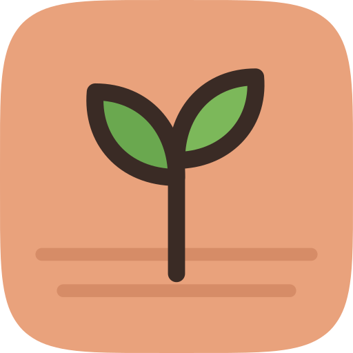
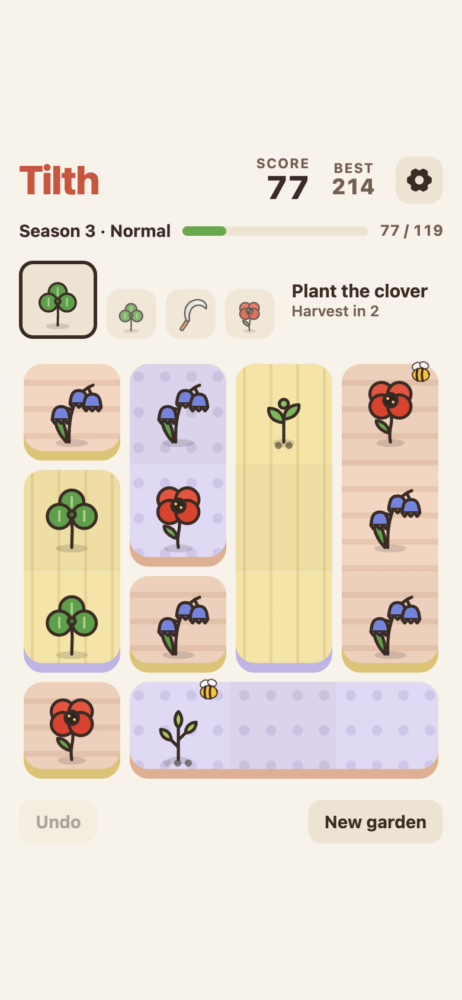
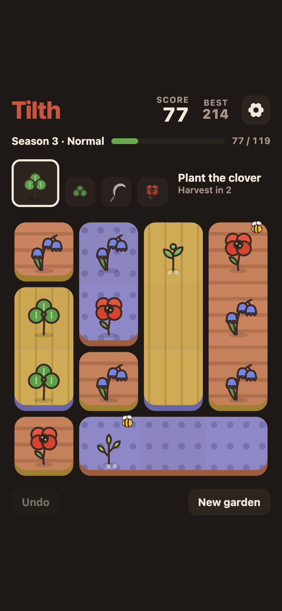
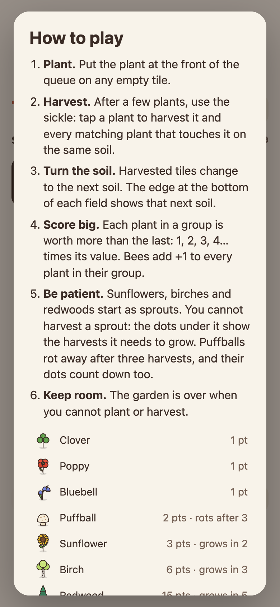
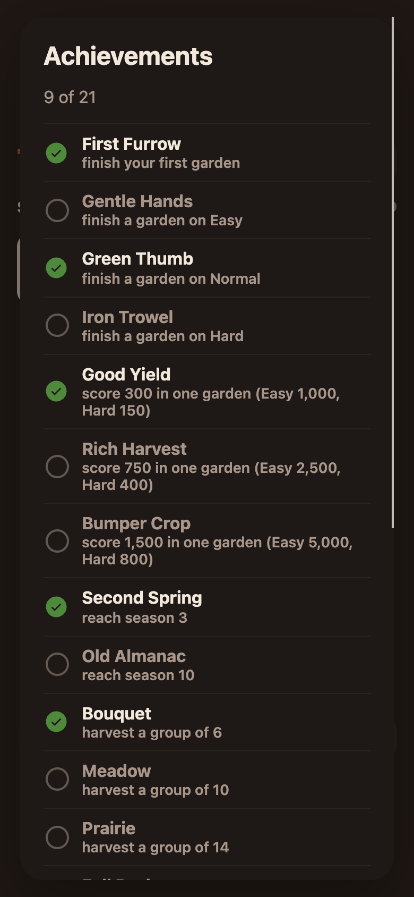

<p align="center">
  
</p>

<h1 align="center">Tilth</h1>
<p align="center"><b>A garden puzzle game</b><br>Plant, harvest, and turn the soil.</p>

<p align="center">
  <a href="https://tilth.plottwist.hu"><b>▶ Play now at tilth.plottwist.hu</b></a><br>
  Free · No ads · No account · Works offline
</p>

<p align="center">
  
  
  
  
</p>

## About this game

Tilth is a calm puzzle game played on a small 4×4 garden. You put plants on empty tiles, and every few turns you use the sickle to harvest a group of matching plants. The soil under the harvested plants turns over, so the garden is always changing. Plan your groups, grow the slow plants, and keep enough room to play.

Short games fit into a coffee break. Long games last for many seasons.

## Features

- **Bigger groups score more.** Each plant in a group is worth more than the last one: 1, 2, 3, 4… times its value.
- **The soil keeps changing.** Harvested tiles turn into the next soil. The colored edge under each field shows which soil comes next.
- **Seven plants.** Clovers, poppies and bluebells are quick. Sunflowers, birches and redwoods start as sprouts and grow over a few harvests, and they are worth much more. Puffballs pay well but rot if you wait too long.
- **Bees.** A bee adds +1 to every plant in its group.
- **Seasons.** Reach the score goal to move into the next season. Each goal is higher than the last.
- **Three difficulties.** On Easy you use the sickle more often and there are more bees. On Hard there are fewer bees, and you plant four times before each harvest.
- **21 achievements**, from your first finished garden to a group of 14 plants.
- **One undo** for the move you regret.
- **Light and dark themes**, which follow your system setting, and soft sound effects you can turn off.
- **Saves every move.** Close the app at any time and continue later.

## Install it

Tilth is a web app. Install it once and it works like a normal app, even with no connection.

- **iPhone and iPad:** open the site in Safari, tap **Share**, then **Add to Home Screen**.
- **Android:** open the site in Chrome and tap **Install** in the banner, or use the browser menu.
- **Desktop:** in Chrome, Edge or Brave, click the install icon in the address bar. In Safari on a Mac, choose **File → Add to Dock**.

## What's new

See the [release notes](https://github.com/pltwst/tilth/releases).

## Information

| | |
|---|---|
| **Category** | Puzzle |
| **Price** | Free, with no ads and no in-app purchases |
| **Size** | About 120 KB |
| **Works on** | Any modern browser: iPhone, iPad, Android, Mac, Windows and Linux |
| **Offline** | Yes, after the first visit |
| **Languages** | English |
| **Privacy** | No account and no cookies. Your games, scores and achievements stay on your device. [Cloudflare Web Analytics](https://www.cloudflare.com/web-analytics/) counts visits without cookies. |

## Contributing

We would love your help. Issues and pull requests are welcome.

### Report a bug or share an idea

[Open an issue](https://github.com/pltwst/tilth/issues/new). For a bug, please include:

- your device and browser,
- the version number from **Settings**,
- what you did, what you expected, and what happened.

A screenshot helps a lot. Ideas for new plants, mechanics and achievements are welcome too.

### Send a pull request

Tilth has no build step and no dependencies. You only need a static file server and Node.js 20 or newer for the tests.

```sh
git clone https://github.com/pltwst/tilth.git
cd tilth
python3 -m http.server 8000 -d public   # then open http://localhost:8000
npm test                                # unit tests, with node:test
```

Where things are:

| File | What it does |
|---|---|
| `public/game.js` | The rules: placing, harvesting, scoring, growth, seasons and modes. It has no DOM code. |
| `public/achievements.js` | The achievement list and the test for each one. |
| `public/app.js` | Drawing the garden, the sheets and settings, and saving. |
| `public/art.js` | The plant, sickle and bee art, as inline SVG. |
| `public/sound.js` | Sound effects, made with Web Audio. There are no audio files. |
| `public/sw.js` | The service worker that makes Tilth work offline. |
| `*.test.js` | Unit tests for the rules and the achievements. |

Before you open a pull request:

1. **Run `npm test`.** If you change the rules, add a test for the change.
2. **Bump `VERSION` in `public/sw.js`** when you change anything in `public/`. Use [semver](https://semver.org): the patch number for fixes, the minor number for new features. Installed copies update only when this number changes.
3. **Keep it simple.** Please do not add a build step or dependencies.
4. **Use only original art and sound.** Do not copy assets from other games.
5. **Keep pull requests small**, with one change in each, and describe what you changed and why.
